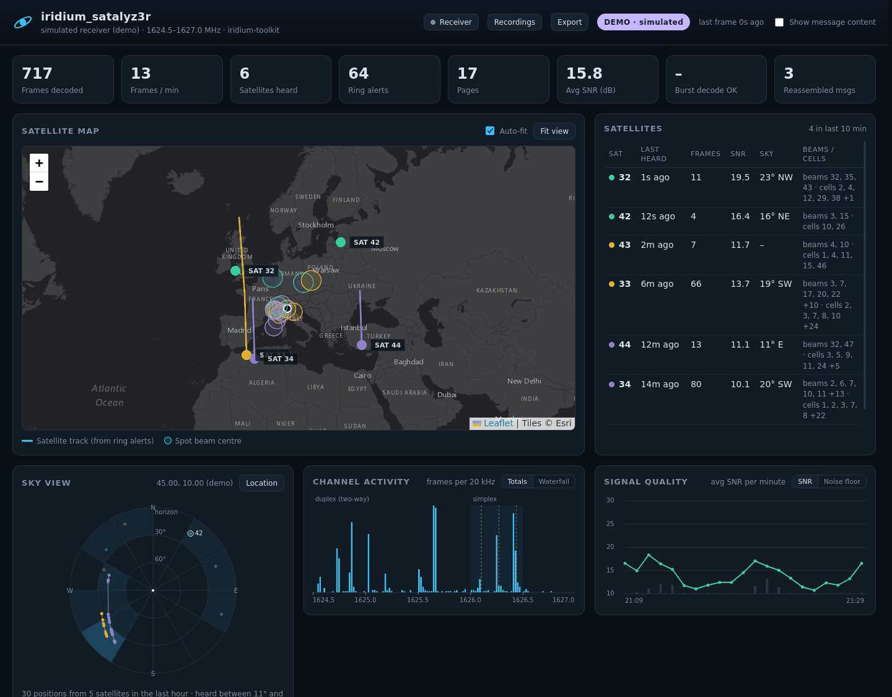
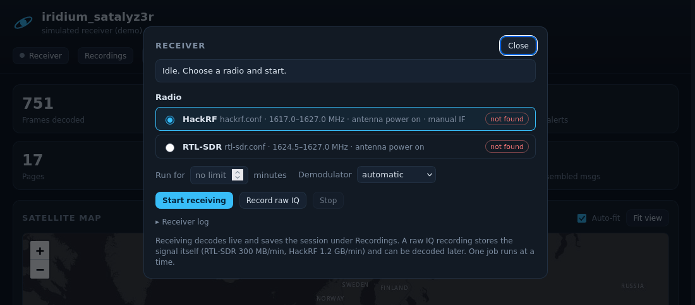
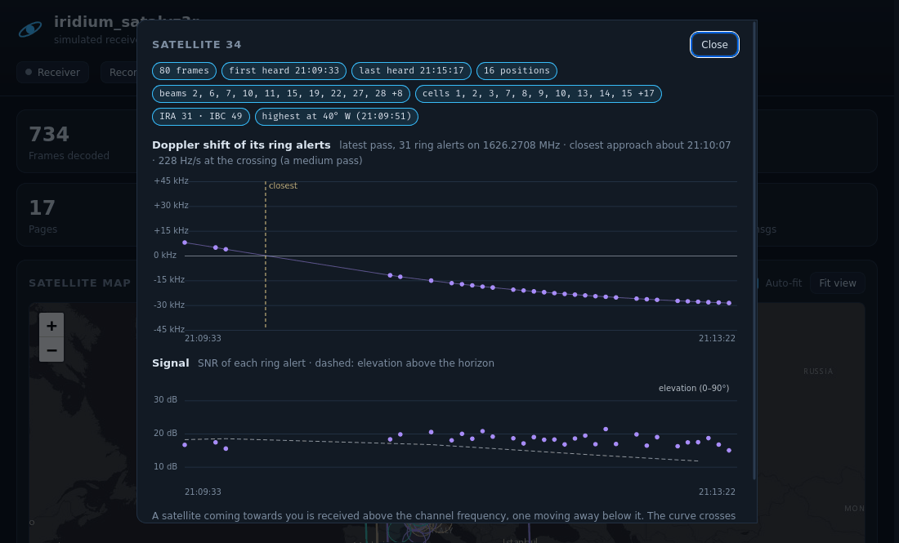

# iridium_satalyz3r

[](https://github.com/Amn3siaK/iridium_satalyz3r/actions/workflows/tests.yml)

**Watch Iridium satellites live in your browser, with a cheap SDR and a GPS antenna.**
iridium_satalyz3r receives the Iridium satellite phone network's downlink, decodes it, and shows what's going on
overhead: where the satellites are, which part of the sky your antenna can see, each satellite's Doppler curve,
paging traffic, aircraft ACARS messages and call activity.



> **Status:** tested on **Kali Linux** with an **RTL-SDR Blog V4** and a **HackRF One** (a clone). Other Debian-based
> systems should work; anything else is untested. Feedback welcome.

## What you can do with it

- **See the constellation**: satellite tracks and spot beams on a map, and a list of every satellite you hear.
- **Judge your antenna**: the *sky view* shows where in the sky you hear satellites and where you don't. Compare antenna
  spots by frames per minute in the recordings list.
- **Click a satellite** for its Doppler curve: when it was closest, how high the pass was, how its signal changed.
- **Read the traffic**: ring-alert pages, pager messages and aircraft ACARS, reassembled from fragments
  (message text stays hidden until you switch it on).
- **Follow call activity**: how many calls, how long, on which channels. Metadata only; voice is never decoded.
- **Control everything from the browser**: start, stop, switch radios, record raw IQ, reopen and export old sessions.
- **Try it without a radio**: `./run-ui.sh --demo` simulates the whole constellation.

## What you need

| | |
|---|---|
| **SDR** | **RTL-SDR Blog V4** (covers the paging and ring-alert channels) or **HackRF One** (covers the whole band). |
| **Antenna** | anything for ~1620 MHz. An **active GPS antenna** usually works, unless it has a narrow GPS-only filter. |
| **A view of the sky** | the biggest factor by far. In testing, 5 minutes outdoors gave **1,100 frames per minute**; indoors 20–50. |
| **Computer** | Linux with Python 3.8+ and GNU Radio 3.9+. A Raspberry Pi 4/5 is enough for the RTL-SDR. |

The radio powers an active antenna through the cable. Using a **passive** antenna? Set `bias=0` in
`configs/rtl-sdr.conf` or `configs/hackrf.conf` first, because some passive antennas short the DC.

## Quick start

```bash
git clone https://github.com/Amn3siaK/iridium_satalyz3r.git
cd iridium_satalyz3r
./install.sh               # installs packages (asks for sudo) and builds the decoders into ./vendor
./run-ui.sh                # RTL-SDR    (SDR=hackrf ./run-ui.sh for a HackRF)
```

Open **http://localhost:8888/**. Frames usually start within a minute; satellites appear on the map once the first
ring alerts arrive. No radio yet? Run `./run-ui.sh --demo` instead.

## A quick tour

**Receiver** (top right) starts and stops the radio, switches between your SDRs, sets a run time, or records raw IQ
to decode later. If something goes wrong, a red bar tells you why, e.g. *"No HackRF found. Is it plugged in?"*



**Click a satellite** in the list for its details. The Doppler curve drops from about +36 kHz (approaching) to −36 kHz
(moving away); where it crosses zero the satellite was closest, and a steep crossing means it passed nearly overhead.



**Sky view** draws every decoded satellite position as seen from your antenna. Over an hour or two, satellites cover
the whole sky, so empty parts are blocked for you. Your location is estimated from the beams you hear; for exact
angles set it with *Location*. It is stored in your browser only.

**Recordings** lists every past run and IQ recording. Open one to view it with all the panels, compare runs by
frames per minute, add a note ("antenna on the balcony"), or delete it. **Export** saves frames (CSV), satellite tracks
(GeoJSON, for QGIS / Google Earth) or a summary (JSON).

**Receiver health** at the bottom shows the decode rate and dropped bursts, and gives tips when something looks wrong.

## Command line

| Command | |
|---|---|
| `./run-ui.sh` | receive and open the dashboard (until Ctrl+C) |
| `./run-ui.sh 1800` | receive for 30 minutes |
| `SDR=hackrf ./run-ui.sh` | use the HackRF |
| `./run-ui.sh --browse` | dashboard only, radio off |
| `./run-ui.sh --demo` | simulated satellites, no radio |
| `./record-iq.sh 600` | record 10 minutes of raw IQ (also opens in IridiScope, SDR++) |
| `./install.sh --check` | check the installation |

More options (ports, demodulator choice, recordings folder, replay) are in [docs/DETAILS.md](docs/DETAILS.md#command-line).

## Common problems

| Problem | Fix |
|---|---|
| RTL-SDR "busy", `usb_claim_interface error -6` | the TV driver grabbed it: `./install.sh --no-deps --blacklist-dvb`, then replug |
| No frames at all | is the antenna powered and connected? Move it to a window, or better, outside |
| Frames, but no satellites on the map | positions come from ring alerts: wait a few minutes or improve the sky view |
| HackRF: thousands of junk frames | Wi-Fi leaking into the HackRF; the default config avoids it ([why](docs/DETAILS.md#why-the-hackrf-uses-a-manual-if)) |
| Map background blank | the map tiles need an internet connection |

Everything else: [full troubleshooting table](docs/DETAILS.md#troubleshooting).

## How it works

```
radio ──► iridium-sniffer ──► iridium-parser ──► dashboard server ──► your browser
          (or gr-iridium)      (iridium-toolkit)   (ui/server.py)
          bursts → bits        bits → frames       maps, Doppler, calls, message reassembly
```

The installer reuses tools you already have (DragonOS ships them) or builds pinned versions into `./vendor`.
The HackRF runs through a manually chosen intermediate frequency, which avoids the Wi-Fi interference that floods it
by default. That fix, the measurements behind the defaults, the config files and the file formats are explained in
**[docs/DETAILS.md](docs/DETAILS.md)**.

## Privacy & legal

- Receiving radio signals is legal in most places, but **intercepting or disclosing other people's communications
  usually is not** (in the EU it is generally a criminal offence). Check your local law.
- iridium_satalyz3r decodes system and position data and **call metadata only. It never decodes voice.**
  Message text (pager, ACARS, SBD) is hidden behind a switch. Subscriber IDs (TMSIs) are masked.
- `logs/` holds everything you received, possibly including message text. It is git-ignored: **don't publish it.**
- The map, the receiver marker and the exports reveal roughly where you are. Keep that in mind before sharing them.

## Credits

Built on [iridium-sniffer](https://github.com/alphafox02/iridium-sniffer) (alphafox02, GPL-3.0),
[gr-iridium](https://github.com/muccc/gr-iridium) and [iridium-toolkit](https://github.com/muccc/iridium-toolkit)
(muccc, GPL-3.0 / BSD-2-Clause), the [RTL-SDR Blog driver](https://github.com/rtlsdrblog/rtl-sdr-blog) (GPL-2.0) and
[Leaflet](https://leafletjs.com) (BSD-2-Clause; map tiles © Esri). They are downloaded by `install.sh` and are not part
of this repository.

## License

Copyright © 2026 Amn3siaK. iridium_satalyz3r is free software under the **GNU General Public License v3.0**
([LICENSE](LICENSE)): you may use, study, change and share it; if you distribute a changed version, it must be under
the GPL as well, with its source.
